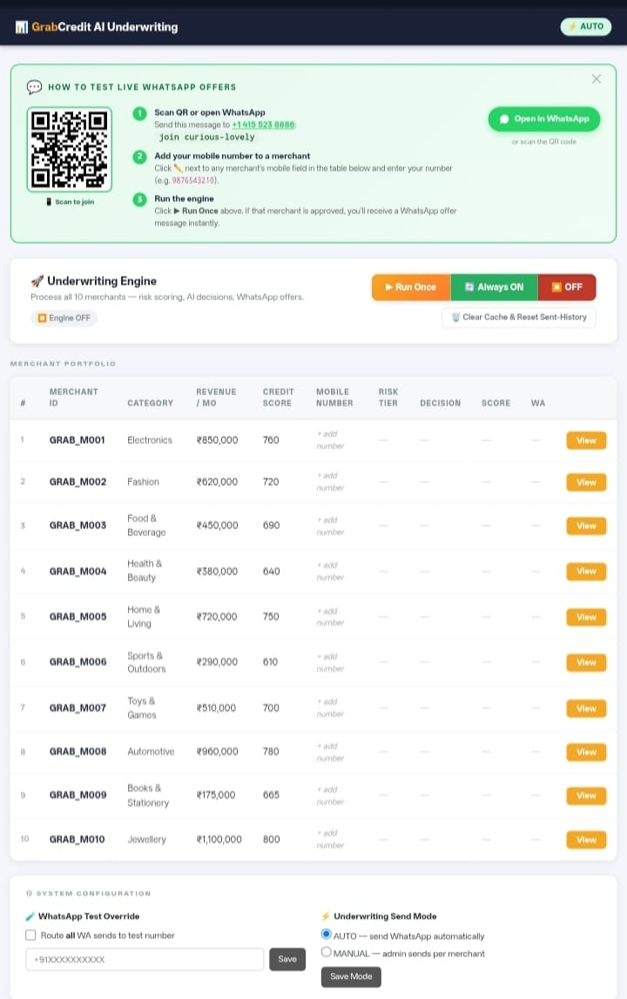
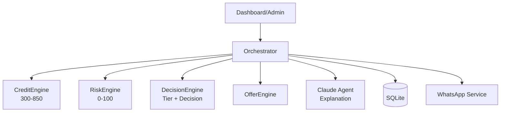

---
# 🤖 GrabOn AI Merchant Underwriting Agent


> **Production-deployed** AI underwriting system — deterministic scoring, Claude AI explanations, and optional WhatsApp offer delivery.
> Live at → **[huggingface.co/spaces/AI-Solutions-KK/grabon-ai-merchant-underwriting-agent](https://huggingface.co/spaces/AI-Solutions-KK/grabon-ai-merchant-underwriting-agent)**

---

## ✅ Latest Update (Final) — Profile-Derived Credit Score

Underwriting flow is now strictly deterministic and profile-driven:

```text
Merchant Profile (API / Seed / SQL)
        │
        ▼
[1] CreditEngine (bank-style weighted model)
    → credit_score: 300–850
        │
        ▼
[2] RiskEngine (hard rules + weighted scoring)
    → risk_score: 0–100
        │
        ▼
[3] DecisionEngine
    → Tier 1 / Tier 2 / Tier 3
    → APPROVED / APPROVED_WITH_CONDITIONS / REJECTED
        │
        ▼
[4] OfferEngine
        │
        ▼
[5] Persist + Optional WhatsApp
```

### Credit score formula (deterministic, no randomness)

Let factor scores be in $[0,100]$:

- $P$ = payment-history proxy
- $A$ = amounts-owed proxy
- $L$ = length/history proxy
- $M$ = credit-mix proxy
- $N$ = new-credit proxy

$$
W = 0.35P + 0.30A + 0.15L + 0.10M + 0.10N
$$

$$
credit\_score = clamp(300 + 5.5W,\ 300,\ 850)
$$

Implementation guarantees:
- Input `credit_score` is accepted for backward compatibility but overwritten by orchestrator Step 0.
- Seed/batch/monitor flows rebuild `MerchantInput` with `credit_score=None` so score is always recomputed.
- Monitor fingerprint excludes stored `credit_score` (it is output, not trigger input).

---

## 📲 Live WhatsApp Test — 3 Steps

> **Evaluators:** You can receive a real WhatsApp underwriting offer message in under 60 seconds.

| Step | Action |
|------|--------|
| **1. Join Sandbox** | Scan dashboard QR or send `join shop-observe` to **+1 415 523 8886** on WhatsApp |
| **2. Add Your Number** | On dashboard click ✏️ next to an approved merchant and save your number |
| **3. Run Engine** | Click **▶ Run Once** — approved merchant gets offer message |

---

## 🏗️ System Architecture



---

## 🎯 Decision Logic

Hard reject rules:
- `credit_score < 550`
- `past_defaults >= 3`

Otherwise:
- `score >= 75` → Tier 1 → APPROVED
- `50 <= score < 75` → Tier 2 → APPROVED_WITH_CONDITIONS
- `score < 50` → Tier 3 → REJECTED

---

## 🌟 Key Features

- Deterministic profile-derived credit score (`CreditEngine`)
- Weighted risk scoring + hard rules (`RiskEngine`)
- Single decision authority (`DecisionEngine`)
- DB fingerprint change detection (`MonitorService`)
- Batch + always-on engine modes
- Optional WhatsApp offer delivery
- Dockerized and HF deploy-ready

---

## 🗂️ Important Files

- `app/engines/credit_engine.py`
- `app/engines/risk_engine.py`
- `app/engines/decision_engine.py`
- `app/orchestrator/orchestrator.py`
- `app/services/merchant_service.py`
- `app/services/monitor_service.py`
- `app/services/engine_service.py`
- `app/db/init_db.py`
- `app/scripts/seed_merchants.py`
- `run_dashboard.bat`

---

## 🧪 Verification

Targeted regression suite passes:

- `tests/test_credit_engine.py`
- `tests/test_orchestrator_credit_auto.py`
- `tests/test_risk_engine.py`
- `tests/test_decision_engine.py`

Result: **17 passed**.

---

## ▶ One-Click Local Run (Windows)

Use root launcher:

- `run_dashboard.bat`

It uses existing `.venv`, starts Uvicorn at `http://localhost:8000`, and opens:

- `http://localhost:8000/dashboard/`

---

## 📦 Manual Local Setup

```bash
python -m venv .venv
.venv\Scripts\activate
pip install -r requirements.txt
python -m uvicorn app.main:app --port 8000
```

---

## 📄 License

Apache 2.0

---

*Built for GrabOn AI Engineering Assignment — deterministic, auditable underwriting pipeline.*
