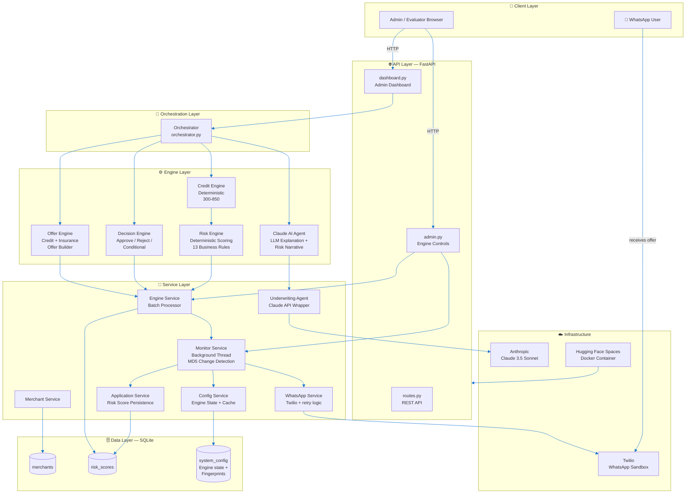
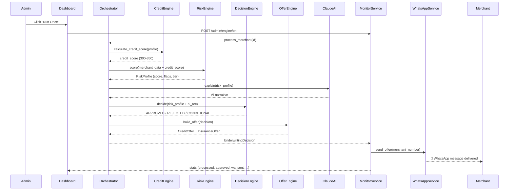

# 🤖 GrabOn AI Merchant Underwriting Agent


> **Production-deployed** AI underwriting system — deterministic scoring, Claude AI decisions, and real WhatsApp offer delivery.
> Live at → **[huggingface.co/spaces/AI-Solutions-KK/grabon-ai-merchant-underwriting-agent](https://huggingface.co/spaces/AI-Solutions-KK/grabon-ai-merchant-underwriting-agent)**

---

## ✅ Latest Update — Deterministic Profile-Derived Credit Scoring

The pipeline now computes `credit_score` directly from merchant profile inputs (bank-style weighted model), then feeds risk and decision engines.

### New underwriting flow

```text
Merchant Profile (API / Seed / SQL)
        │
        ▼
[1] CreditEngine (weighted deterministic model)
    → credit_score: 300–850
        │
        ▼
[2] RiskEngine (hard rules + weighted scoring)
    → risk_score: 0–100
        │
        ▼
[3] DecisionEngine (single authority)
    → APPROVED / APPROVED_WITH_CONDITIONS / REJECTED
        │
        ▼
[4] OfferEngine
        │
        ▼
[5] Persist + Optional WhatsApp
```

### Credit score formula

Let factor scores be in $[0,100]$:

- $P$ = payment-history proxy
- $A$ = amounts-owed proxy
- $L$ = length/history proxy
- $M$ = credit-mix proxy
- $N$ = new-credit proxy

$$
W = 0.35P + 0.30A + 0.15L + 0.10M + 0.10N
$$

$$
credit\_score = clamp(300 + 5.5W,\ 300,\ 850)
$$

Implementation notes:
- Incoming `credit_score` is accepted for compatibility but recomputed in orchestrator Step 0.
- Seed, monitor, and batch flows rebuild input with `credit_score=None`.
- Monitor fingerprint excludes `credit_score` (derived output).

---

## 📲 Live WhatsApp Test — 3 Steps

> **Evaluators:** You can receive a real WhatsApp underwriting offer message in under 60 seconds.

| Step | Action |
|------|--------|
| **1. Join Sandbox** | Scan the QR code on the dashboard or send `join shop-observe` to **+1 415 523 8886** on WhatsApp |
| **2. Add Your Number** | On the dashboard, click ✏️ next to any approved merchant and enter your number |
| **3. Run Engine** | Click **▶ Run Once** — if the merchant is APPROVED, you'll receive a live WhatsApp offer message |

---

## 🏗️ System Architecture



---

## 🚀 Overview

This system automates merchant underwriting for **GrabCredit** and **GrabInsure** products. It takes raw merchant data, computes a deterministic credit score from profile signals, runs risk scoring, gets an AI-generated explanation from Claude, makes a final credit/insurance offer decision, and can deliver the offer directly to the merchant via **WhatsApp**.

### What makes this production-grade (not a demo)
- ✅ Real WhatsApp delivery via Twilio sandbox
- ✅ Real Claude AI calls
- ✅ Persistent SQLite DB
- ✅ MD5 fingerprint change detection
- ✅ Background daemon engine with 60s polling (`ALWAYS_ON` mode)
- ✅ Dockerized and deployed on Hugging Face Spaces
- ✅ Idempotent runs (no spam on unchanged merchants)

---

## 🔄 Decision Flow



---

## ⚙️ Engine Modes

| Mode | Behaviour |
|------|-----------|
| **▶ Run Once** | Synchronous single-pass. Clears cache → processes merchants → returns summary. |
| **∞ Always ON** | Background daemon polls every 60 seconds; re-processes changed merchants only. |
| **⏹ OFF** | Stops background thread immediately. |
| **Clear Cache** | Clears fingerprints + resets `whatsapp_status`. |

---

## 🗂 Project Structure (Core Files)

- `app/engines/credit_engine.py`
- `app/engines/risk_engine.py`
- `app/engines/decision_engine.py`
- `app/engines/offer_engine.py`
- `app/orchestrator/orchestrator.py`
- `app/services/monitor_service.py`
- `app/services/merchant_service.py`
- `app/services/engine_service.py`
- `app/db/init_db.py`
- `app/scripts/seed_merchants.py`
- `run_dashboard.bat`

---

## 🧪 Verification

Focused regression tests include:

- `tests/test_credit_engine.py`
- `tests/test_orchestrator_credit_auto.py`
- `tests/test_risk_engine.py`
- `tests/test_decision_engine.py`

Latest result: **17 passed**.

---

## ▶ One-Click Local Run (Windows)

Use root launcher:

- `run_dashboard.bat`

This uses existing `.venv`, starts Uvicorn at `http://localhost:8000`, and opens:

- `http://localhost:8000/dashboard/`

---

## 📦 Manual Local Setup

```bash
python -m venv .venv
.venv\Scripts\activate
pip install -r requirements.txt
python -m uvicorn app.main:app --port 8000
```

---

## 📄 License

Apache 2.0

---

*Built for GrabOn AI Engineering Assignment — production-deployed, deterministic, auditable underwriting pipeline.*
